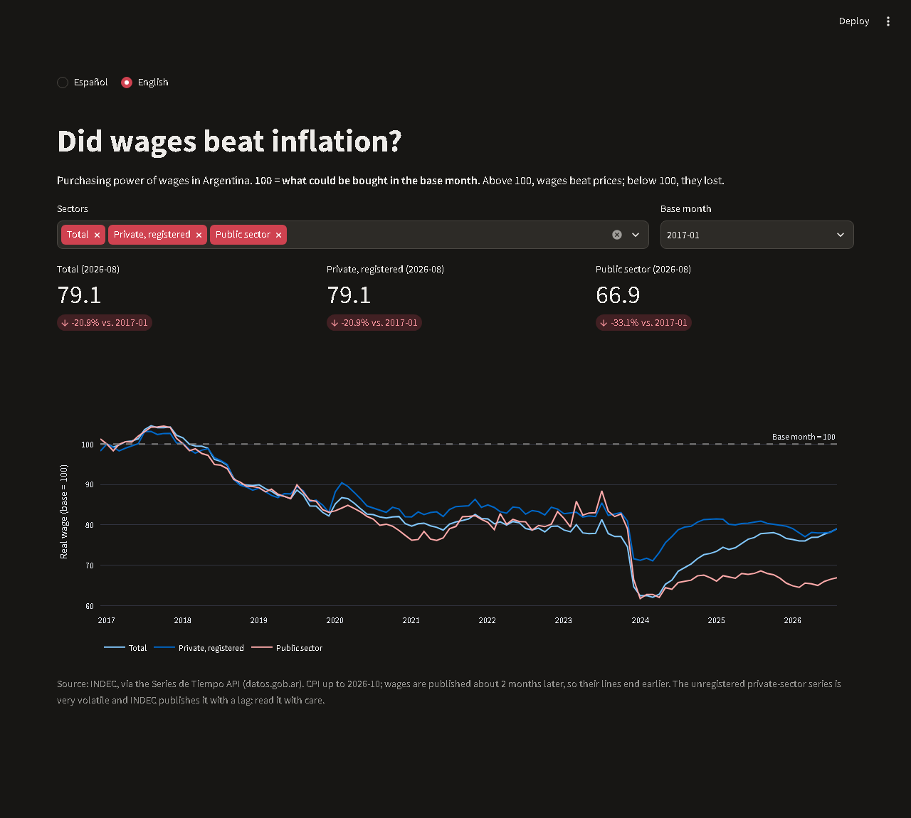
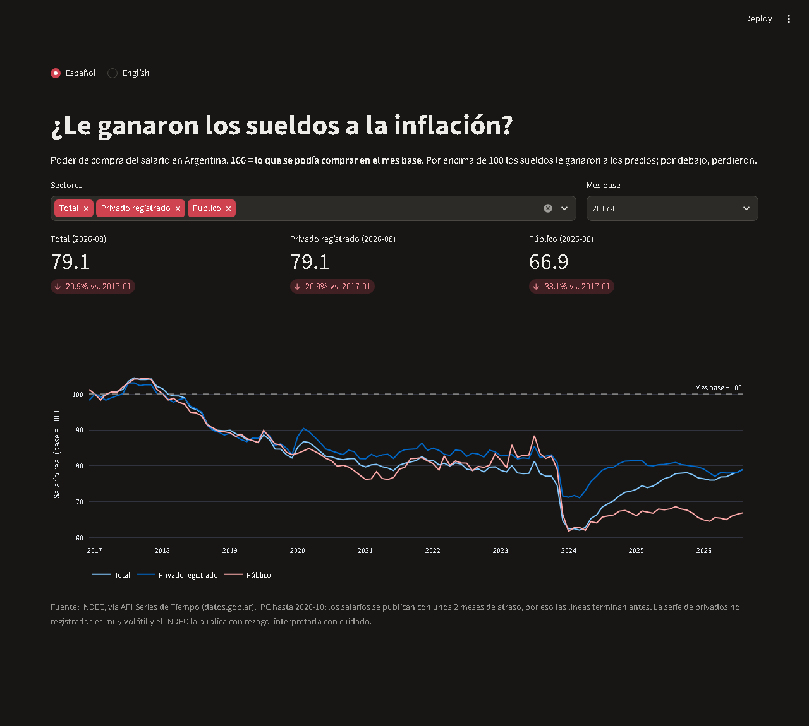

# Did wages beat inflation? · ¿Le ganaron los sueldos a la inflación?

**▶ Live app / App online: [dashboard-salarios-inflacion-vibe-coded.streamlit.app](https://dashboard-salarios-inflacion-vibe-coded-gpdhngjafuthuk8aidv7p7.streamlit.app/)** ([English](https://dashboard-salarios-inflacion-vibe-coded-gpdhngjafuthuk8aidv7p7.streamlit.app/?lang=en))

**[English](#english) · [Español](#español)**



---

## English

An interactive dashboard that answers one question with official data: **did wages in Argentina keep up with prices?**
It shows the *real wage* (the purchasing power of wages) by sector since 2016, built from INDEC's consumer price index and wage index.

> **Vibe coded:** built step by step with [Claude Code](https://claude.com/claude-code) as an AI pair programmer. I made the design and analysis decisions (data sources, how to treat missing months, correcting the unregistered-wage lag); the AI wrote most of the code, and every piece is covered by tests or checked by hand.

### How to read it

- **100 = what a salary could buy in the base month** you choose.
- Above 100, wages grew more than prices; below 100, they lost purchasing power.
- Example (base Jan-2017, latest data Aug-2026): total wages **79.1**, i.e. about **21% less** purchasing power; public sector **66.9** (−33%).

### Features

- Sector selector: total, private registered, public, private unregistered.
- Selectable base month: every line is rebased to 100 on that month.
- Spanish / English switch (`?lang=en` in the URL opens it in English).
- Only months with data in both series are compared (wages are published ~2 months after CPI).

### How it works

```
datos.gob.ar API ──► update_data.py ──► data/datos.db (SQLite) ──► app.py (Streamlit + Plotly)
   (INDEC series)      run by hand          stored locally            reads only the database
```

| File | Responsibility |
|---|---|
| `src/sources.py` | Downloads a series from the API. Months without data are skipped, never set to 0. |
| `src/database.py` | SQLite storage in long format (`series`, `observations`). Saving twice does not duplicate. |
| `src/calculations.py` | Pure functions: `rebase()` and `real_wage()`. |
| `src/i18n.py` + `translations/` | Every interface text, in Spanish and English. |
| `update_data.py` | Refreshes the database from the API. |
| `app.py` | The dashboard. It never calls the API. |
| `tests/` | 9 pytest tests for calculations, storage and translations. |

**Stack:** Python 3.14 · requests · SQLite · Streamlit · Plotly · pytest

### Run it locally (Windows / PowerShell)

```powershell
python -m venv .venv
.\.venv\Scripts\python.exe -m pip install -r requirements.txt
.\.venv\Scripts\streamlit run app.py          # opens http://localhost:8501
```

Refresh the data and run the tests:

```powershell
.\.venv\Scripts\python.exe update_data.py
.\.venv\Scripts\python.exe -m pytest -v
```

### Data sources and caveats

- **CPI** (`148.3_INIVELNAL_DICI_M_26`) and **wage index** series (`149.1_…`) from INDEC, via the [Series de Tiempo API](https://apis.datos.gob.ar/series/api/) of datos.gob.ar.
- Wages are published about two months after CPI, so wage lines end earlier.
- The **unregistered private-sector** series comes from INDEC's household survey (EPH) and has a **5-month lag**: the value published for August reflects March wages. The dashboard shifts it 5 months back before comparing it with CPI; without this, the 2024 drop looks far deeper than it was (minimum 37 instead of 54, base Jan-2017). It stays out of the default view, and the total index includes it uncorrected (~20% weight).

---

## Español



Un dashboard interactivo que responde una pregunta con datos oficiales: **¿los sueldos en Argentina le ganaron a los precios?**
Muestra el *salario real* (el poder de compra del sueldo) por sector desde 2016, a partir del IPC y el índice de salarios del INDEC.

> **Vibe coded:** construido paso a paso con [Claude Code](https://claude.com/claude-code) como programador de IA en pareja. Yo tomé las decisiones de diseño y de análisis (fuentes de datos, qué hacer con los meses sin dato, corregir el rezago de los no registrados); la IA escribió la mayor parte del código, y cada parte está cubierta por tests o verificada a mano.

### Cómo leerlo

- **100 = lo que se podía comprar con el sueldo en el mes base** que elijas.
- Por encima de 100, los sueldos subieron más que los precios; por debajo, perdieron poder de compra.
- Ejemplo (base ene-2017, último dato ago-2026): salarios totales **79,1**, o sea alrededor de **21% menos** poder de compra; sector público **66,9** (−33%).

### Funcionalidades

- Selector de sectores: total, privado registrado, público, privado no registrado.
- Mes base elegible: todas las líneas se re-basan a 100 en ese mes.
- Switch español / inglés (`?lang=en` en la dirección la abre en inglés).
- Solo se comparan meses con dato en ambas series (los salarios se publican ~2 meses después que el IPC).

### Cómo funciona

```
API datos.gob.ar ──► update_data.py ──► data/datos.db (SQLite) ──► app.py (Streamlit + Plotly)
 (series INDEC)      se corre a mano       guardado local            solo lee la base
```

| Archivo | Responsabilidad |
|---|---|
| `src/sources.py` | Descarga una serie de la API. Los meses sin dato se saltean, nunca se ponen en 0. |
| `src/database.py` | Guarda en SQLite en formato largo (`series`, `observations`). Guardar dos veces no duplica. |
| `src/calculations.py` | Funciones puras: `rebase()` y `real_wage()`. |
| `src/i18n.py` + `translations/` | Todos los textos de la interfaz, en español e inglés. |
| `update_data.py` | Actualiza la base desde la API. |
| `app.py` | El dashboard. Nunca llama a la API. |
| `tests/` | 9 tests con pytest para cálculos, base de datos y traducciones. |

**Tecnologías:** Python 3.14 · requests · SQLite · Streamlit · Plotly · pytest

### Correrlo en tu computadora (Windows / PowerShell)

```powershell
python -m venv .venv
.\.venv\Scripts\python.exe -m pip install -r requirements.txt
.\.venv\Scripts\streamlit run app.py          # abre http://localhost:8501
```

Actualizar los datos y correr los tests:

```powershell
.\.venv\Scripts\python.exe update_data.py
.\.venv\Scripts\python.exe -m pytest -v
```

### Fuentes y advertencias

- **IPC** (`148.3_INIVELNAL_DICI_M_26`) e **índices de salarios** (`149.1_…`) del INDEC, vía la [API Series de Tiempo](https://apis.datos.gob.ar/series/api/) de datos.gob.ar.
- Los salarios se publican unos dos meses después que el IPC, por eso sus líneas terminan antes.
- La serie de **privados no registrados** sale de la Encuesta Permanente de Hogares (EPH) y tiene **5 meses de rezago**: el dato publicado como agosto refleja sueldos de marzo. El dashboard la corre 5 meses hacia atrás antes de compararla con el IPC; sin esa corrección, la caída de 2024 parece mucho más profunda de lo que fue (mínimo 37 en vez de 54, base ene-2017). No aparece en la vista inicial, y el índice total la incluye sin corregir (pesa ~20%).
